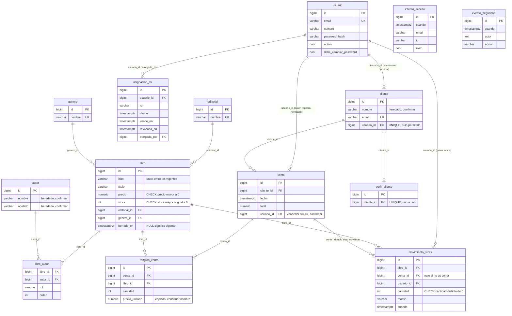

# Modelo de Datos

> **Los nombres de tablas y columnas son obligatorios**: los casos de prueba y la corrección los usan.
> Se pueden agregar columnas, pero no quitar ni renombrar las indicadas (consigna, «Modelo de
> dominio», p. 4). Español, singular, `snake_case`, tal como están impresos.

## Dominios

| Dominio | Tablas | Estado |
|---|---|---|
| Acceso | `usuario`, `asignacion_rol`, `intento_acceso`, `evento_seguridad` | **Nuevo** en este parcial |
| Catálogo | `editorial`, `genero`, `autor`, `libro`, `libro_autor` | Heredado; `libro` **cambia** (borrado lógico + ISBN parcial) |
| Clientes | `cliente`, `perfil_cliente` | Heredado; `cliente` **cambia** (`usuario_id`) |
| Ventas | `venta`, `renglon_venta` | Heredado, sin cambios de esquema |
| Stock | `movimiento_stock` | **Nuevo**; sólo agregado |

## ERD (Entity Relationship Diagram)



`intento_acceso` y `evento_seguridad` **no se relacionan con ninguna otra tabla** (consigna, figura 1).
El diagrama las dibuja sueltas a propósito: no hay FK hacia `usuario`.

### Vista ASCII de las relaciones

```
usuario 1 ──0..1── cliente            (cliente.usuario_id UNIQUE, nulo permitido)
usuario 1 ───n──── asignacion_rol     (usuario_id; a lo sumo UNA abierta por rol)
usuario 1 ───n──── asignacion_rol     (otorgada_por, nulo: quién otorgó el rol)
usuario 1 ───n──── movimiento_stock   (usuario_id: quién movió el stock)
usuario 1 ───n──── venta              (vendedor — heredado, confirmar SU-07)

cliente 1 ───n──── venta              (venta.cliente_id)
cliente 1 ──0..1── perfil_cliente     (perfil_cliente.cliente_id)

venta 1 ──1..n──── renglon_venta      (venta_id)
libro 1 ───n────── renglon_venta      (libro_id)
libro 1 ───n────── movimiento_stock   (libro_id)
libro 1 ───n────── libro_autor        (libro_id)
autor 1 ───n────── libro_autor        (autor_id)
libro n ───1────── editorial          (editorial_id)
libro n ───1────── genero             (genero_id)

venta 1 ───n────── movimiento_stock   (venta_id, NULO si el movimiento no viene de una venta)

intento_acceso      — sin relaciones
evento_seguridad    — sin relaciones (actor es TEXTO, no una FK a usuario)
```

Cardinalidades que importan:

- `usuario` **1 — 0..1** `cliente`: un cliente puede tener acceso web, o no.
- `usuario` **1 — n** `asignacion_rol`: una fila por rol otorgado; a lo sumo **una abierta por rol**.
- `libro` **1 — n** `movimiento_stock`: el stock es la suma de esas filas.
- `venta` **1 — 1..n** `renglon_venta`: una venta nace con al menos un renglón.
- `movimiento_stock.venta_id` es **nulo** cuando el movimiento no viene de una venta (alta o
  reposición).

## Entidades

Convenciones de esta sección:

- `NN` = `NOT NULL`. `NULL` = admite nulo. «def.» = valor por defecto.
- Los tipos de `id` **no los fija la consigna**: se usa la convención del TP (entero
  autoincremental / `bigint identity`). Ver `09_decisiones_y_supuestos.md` (SU-01).
- Los `default` de `activo` (`true`), `debe_cambiar_password` (`false`, y `true` en el alta de
  personal) y `desde`/`cuando` (`now()`) son **convención**: la consigna fija las columnas, no sus
  valores por defecto.
- `(heredado TP cap 1-4 — confirmar contra el repo)` marca una columna que este PDF **no restate**:
  existe en el TP anterior y hay que confirmar nombre y tipo contra el repositorio del grupo.

---

### `usuario` — NUEVA

| Columna | Tipo | Null | Def. | Restricción |
|---|---|---|---|---|
| `id` | bigint identity | NN | — | PK |
| `email` | varchar | NN | — | **UNIQUE** (RN-01) |
| `nombre` | varchar | NN | — | — |
| `password_hash` | varchar | NN | — | Hash bcrypt; **nunca** sale en una respuesta |
| `activo` | boolean | NN | `true` | Si es `false`, `get_usuario_actual` responde **401** |
| `debe_cambiar_password` | boolean | NN | `true` en el alta de personal | Dispara RN-06 |

**No tiene columna `rol`.** «LOS ROLES VIVEN EN SU PROPIA TABLA» (consigna, p. 6).

Índices: PK + UNIQUE sobre `email`.

---

### `asignacion_rol` — NUEVA

| Columna | Tipo | Null | Def. | Restricción |
|---|---|---|---|---|
| `id` | bigint identity | NN | — | PK |
| `usuario_id` | bigint | NN | — | **FK → `usuario.id`**; índice propio |
| `rol` | varchar | NN | — | **`CHECK (rol IN ('ADMIN','VENDEDOR','CLIENTE'))`** |
| `desde` | timestamptz | NN | `now()` | Inicio de vigencia |
| `vence_en` | timestamptz | NULL | `NULL` | Fin de vigencia; si es `NULL`, no vence |
| `revocada_en` | timestamptz | NULL | `NULL` | Revocación; la fila **nunca se borra** |
| `otorgada_por` | bigint | NULL | `NULL` | **FK → `usuario.id`** (quién otorgó); índice propio |

Restricciones e índices:

- `CHECK (rol IN ('ADMIN','VENDEDOR','CLIENTE'))`.
- **Índice único parcial** `(usuario_id, rol) WHERE revocada_en IS NULL` → RN-03: a lo sumo una
  asignación **abierta** por rol. Permite historial infinito de filas cerradas.
- Índice sobre `usuario_id` (FK; PostgreSQL no lo crea solo).
- Índice sobre `otorgada_por` (FK nueva).
- «Las filas no se borran nunca»: revocar escribe `revocada_en`.

---

### `intento_acceso` — NUEVA

| Columna | Tipo | Null | Def. | Restricción |
|---|---|---|---|---|
| `id` | bigint identity | NN | — | PK |
| `cuando` | timestamptz | NN | `now()` | Momento del intento |
| `email` | varchar | NN | — | Correo tal como se tipeó (exista o no la cuenta) |
| `ip` | varchar | NN | — | IP del cliente |
| `exito` | boolean | NN | — | `true` si el login prosperó |

- **Sin FKs**, sin `CHECK` extra.
- **Índice `(email, ip, cuando)`**: es el que usa el conteo de RN-07
  (`email = :email AND ip = :ip AND cuando > now() - 60s`).
- Se escribe desde **una sesión y una transacción propias, que se confirman siempre** (ver
  `07_flujos_principales.md`, flujo 2).

---

### `evento_seguridad` — NUEVA

| Columna | Tipo | Null | Def. | Restricción |
|---|---|---|---|---|
| `id` | bigint identity | NN | — | PK |
| `cuando` | timestamptz | NN | `now()` | — |
| `actor` | **text** | NN | — | **Texto, no FK.** Puede ser un email de usuario o `'SISTEMA'` |
| `accion` | varchar | NN | — | Descripción de lo ocurrido |

- «Sin restricciones extra» (consigna, p. 5): sin FK, sin CHECK.
- `actor` es texto justamente para que el seed pueda escribir `SISTEMA` sin un usuario ficticio.
- Se escribe en la **misma transacción** que el cambio que audita (RN-16).

---

### `cliente` — HEREDADA, CAMBIA

| Columna | Tipo | Null | Def. | Restricción |
|---|---|---|---|---|
| `id` | bigint identity | NN | — | PK |
| `nombre` | varchar | NN | — | `(heredado TP cap 1-4 — confirmar contra el repo)` |
| `apellido` | varchar | NN | — | `(heredado TP cap 1-4 — confirmar contra el repo)` |
| `email` | varchar | NN | — | **UNIQUE** — «`email` sigue UNIQUE» (RN-01) |
| `telefono` | varchar | NULL | — | `(heredado TP cap 1-4 — confirmar contra el repo)` |
| **`usuario_id`** | bigint | **NULL** | `NULL` | **UNIQUE**; **FK → `usuario.id`**; **nuevo** |

- `usuario_id` **nulo permitido**: un cliente puede tener, o no, acceso por la web. Los clientes de
  mostrador (Tomás Ríos en el seed) no tienen usuario.
- `UNIQUE(usuario_id)`: un usuario no puede estar ligado a dos fichas de cliente. En PostgreSQL un
  `UNIQUE` con nulos admite múltiples `NULL`, que es exactamente lo que se quiere.
- `Cliente.usuario` **devuelve un objeto y no una lista** (relación uno a uno, Ejercicio 2).
- La navegación se declara **en los dos extremos**: `Cliente.usuario` y `Usuario.cliente`.

---

### `perfil_cliente` — HEREDADA, SIN CAMBIOS

| Columna | Tipo | Null | Def. | Restricción |
|---|---|---|---|---|
| `id` | bigint identity | NN | — | PK |
| `cliente_id` | bigint | NN | — | **FK → `cliente.id`**, UNIQUE (1—1) |
| `direccion` | varchar | NULL | — | `(heredado TP cap 1-4 — confirmar contra el repo)` |
| `fecha_nacimiento` | date | NULL | — | `(heredado TP cap 1-4 — confirmar contra el repo)` |
| … | — | — | — | Cualquier otra columna: `(heredado TP cap 1-4 — confirmar contra el repo)` |

«Las tablas que no aparecen en esta sección (`editorial`, `genero`, `autor`, `libro_autor` y
`perfil_cliente`) no cambian respecto del TP» (consigna, p. 4).

---

### `libro` — HEREDADA, CAMBIA

| Columna | Tipo | Null | Def. | Restricción |
|---|---|---|---|---|
| `id` | bigint identity | NN | — | PK |
| `isbn` | varchar | NN | — | **Ya NO es UNIQUE común**: índice único parcial (ver abajo) |
| `titulo` | varchar | NN | — | Búsqueda con parámetros ligados, sin distinguir mayúsculas |
| `precio` | **numeric** | NN | — | **`CHECK (precio > 0)`** sigue vigente |
| `stock` | integer | NN | — | **`CHECK (stock >= 0)`** sigue vigente; **sólo se escribe por movimientos** |
| `editorial_id` | bigint | NN | — | **FK → `editorial.id`**; índice |
| `genero_id` | bigint | NN | — | **FK → `genero.id`**; índice |
| **`borrado_en`** | **timestamptz** | **NULL** | `NULL` | **Nuevo**, «con zona»; `NULL` = vigente |
| … | — | — | — | Otras columnas del TP (año, páginas, etc.): `(heredado TP cap 1-4 — confirmar contra el repo)` |

Restricciones e índices:

- **Índice único parcial** `(isbn) WHERE borrado_en IS NULL` **en lugar del UNIQUE** → RN-01: el ISBN
  es único **entre los vigentes**.
- `CHECK (precio > 0)` y `CHECK (stock >= 0)` siguen vigentes (la consigna dice que siguen aunque no
  se repitan).
- `borrado_en IS NULL` ⇒ el libro aparece en el catálogo y se puede vender/reponer (RN-13).

---

### `libro_autor` — HEREDADA, SIN CAMBIOS

| Columna | Tipo | Null | Def. | Restricción |
|---|---|---|---|---|
| `libro_id` | bigint | NN | — | **FK → `libro.id`** |
| `autor_id` | bigint | NN | — | **FK → `autor.id`** |
| `rol` | varchar | NN | — | Valores vistos en la consigna: `'coautor'` (ejemplo de `POST /libros`) |
| `orden` | integer | NN | — | Orden de presentación |
| … | — | — | — | PK/UNIQUE compuesta: `(heredado TP cap 1-4 — confirmar contra el repo)` |

Vive en el módulo `libros` (consigna, p. 9). El alta de libro recibe `autores: [{autor_id, rol,
orden}]`.

---

### `editorial` — HEREDADA, SIN CAMBIOS

| Columna | Tipo | Null | Def. | Restricción |
|---|---|---|---|---|
| `id` | bigint identity | NN | — | PK |
| `nombre` | varchar | NN | — | **UNIQUE** (RN-01); 409 con mensaje propio |
| … | — | — | — | `(heredado TP cap 1-4 — confirmar contra el repo)` |

### `genero` — HEREDADA, SIN CAMBIOS

| Columna | Tipo | Null | Def. | Restricción |
|---|---|---|---|---|
| `id` | bigint identity | NN | — | PK |
| `nombre` | varchar | NN | — | **UNIQUE** (RN-01); 409 con mensaje propio |
| … | — | — | — | `(heredado TP cap 1-4 — confirmar contra el repo)` |

### `autor` — HEREDADA, SIN CAMBIOS

| Columna | Tipo | Null | Def. | Restricción |
|---|---|---|---|---|
| `id` | bigint identity | NN | — | PK |
| `nombre` | varchar | NN | — | `(heredado TP cap 1-4 — confirmar contra el repo)` |
| `apellido` | varchar | NN | — | `(heredado TP cap 1-4 — confirmar contra el repo)` |
| … | — | — | — | `(heredado TP cap 1-4 — confirmar contra el repo)` |

---

### `venta` — HEREDADA, SIN CAMBIOS DE ESQUEMA

| Columna | Tipo | Null | Def. | Restricción |
|---|---|---|---|---|
| `id` | bigint identity | NN | — | PK |
| `cliente_id` | bigint | NN | — | **FK → `cliente.id`**; índice |
| `fecha` | timestamptz | NN | `now()` | `(heredado TP cap 1-4 — confirmar contra el repo)` |
| `total` | **numeric** | NN | — | Calculado por el servidor; nunca viaja en el cuerpo |
| `usuario_id` | bigint | ? | — | Vendedor que la registró: **`(heredado? — confirmar contra el repo)`**. Ver `10_preguntas_abiertas.md` (AB-02) |
| … | — | — | — | `(heredado TP cap 1-4 — confirmar contra el repo)` |

- **Las ventas no se modifican**: no hay `PATCH` (RN-09).
- El detalle incluye cliente, renglones y el libro de cada renglón **aunque el libro esté dado de
  baja** (RN-13).

### `renglon_venta` — HEREDADA, SIN CAMBIOS

| Columna | Tipo | Null | Def. | Restricción |
|---|---|---|---|---|
| `id` | bigint identity | NN | — | PK |
| `venta_id` | bigint | NN | — | **FK → `venta.id`**; índice |
| `libro_id` | bigint | NN | — | **FK → `libro.id`**; índice |
| `cantidad` | integer | NN | — | `> 0`; sin libros repetidos en una misma venta (RN-09) |
| `precio_unitario` | **numeric** | NN | — | **Copiado del libro al registrar**; el nombre exacto es `(heredado TP cap 1-4 — confirmar contra el repo)` |
| … | — | — | — | `(heredado TP cap 1-4 — confirmar contra el repo)` |

Vive en el módulo `ventas` (consigna, p. 9).

---

### `movimiento_stock` — NUEVA, SÓLO AGREGADO

| Columna | Tipo | Null | Def. | Restricción |
|---|---|---|---|---|
| `id` | bigint identity | NN | — | PK |
| `libro_id` | bigint | NN | — | **FK → `libro.id`**; índice |
| `venta_id` | bigint | **NULL** | `NULL` | **FK → `venta.id`**; índice. `NULL` si no viene de una venta |
| `usuario_id` | bigint | NN | — | **FK → `usuario.id`**; índice. Quién provocó el movimiento |
| `cantidad` | integer | NN | — | **`CHECK (cantidad <> 0)`**. Positiva = entrada, negativa = salida |
| `motivo` | varchar | NN | — | `'Stock inicial'`, reposición o venta (ver SU-04) |
| `cuando` | timestamptz | NN | `now()` | — |

**Invariante central del parcial:**

```
para cada libro:  libro.stock  =  SUM(movimiento_stock.cantidad)
```

«Esa igualdad es la que se verifica después de cada caso de venta, y se rompe si alguna parte del
código escribe el stock sin dejar un movimiento» (consigna, p. 6).

**Sólo agregado (RN-12):** un disparador, instalado por la **cuarta migración escrita a mano**,
rechaza **cualquier `UPDATE` o `DELETE`** sobre esta tabla, venga de donde venga. Corregir un
movimiento es **compensarlo con otro**, no editarlo.

Valores de `cantidad` en el seed: `+11 +5 +10 +3 +1` (stock inicial de los cinco libros; Rayuela y
Ficciones se cargan con 11 y 10) y `−1`, `−2` (salidas de la venta 1).

---

## Índices y restricciones — vista consolidada

| Tabla | Índice / restricción | Definición | Para qué |
|---|---|---|---|
| `usuario` | UNIQUE | `(email)` | RN-01 |
| `asignacion_rol` | **único parcial** | `(usuario_id, rol) WHERE revocada_en IS NULL` | RN-03: una asignación abierta por rol |
| `asignacion_rol` | índice | `(usuario_id)` | FK + consulta de roles vigentes de cada petición |
| `asignacion_rol` | índice | `(otorgada_por)` | FK |
| `asignacion_rol` | CHECK | `rol IN ('ADMIN','VENDEDOR','CLIENTE')` | No inventar roles |
| `intento_acceso` | índice | `(email, ip, cuando)` | Conteo de RN-07 |
| `cliente` | UNIQUE | `(email)` | RN-01 (sigue vigente) |
| `cliente` | UNIQUE | `(usuario_id)` | Un usuario ↔ una ficha |
| `libro` | **único parcial** | `(isbn) WHERE borrado_en IS NULL` | RN-01 + RN-13: reusar el ISBN de un libro dado de baja |
| `libro` | CHECK | `precio > 0`, `stock >= 0` | Siguen vigentes del TP |
| `movimiento_stock` | CHECK | `cantidad <> 0` | Un movimiento de cero no es un movimiento |
| `movimiento_stock` | índice | `(libro_id)`, `(venta_id)`, `(usuario_id)` | FKs |
| `movimiento_stock` | disparador | rechaza `UPDATE` y `DELETE` | RN-12 |

### Las dos trampas que la consigna remarca

**1. El ISBN deja de ser un UNIQUE común.** `libro` ahora tiene borrado lógico: la fila dada de baja
sigue en la tabla porque las ventas viejas la apuntan. Con un `UNIQUE` común, la librería no podría
volver a cargar un libro con un ISBN que dio de baja, y la base respondería «ya existe» de un libro
que la aplicación no muestra en ningún listado. Por eso la unicidad es **sólo entre los vigentes**.

**2. `usuario` no tiene columna `rol`.** Si alguien agrega `usuario.rol`, RN-03, RN-04 y RN-05 dejan
de poder cumplirse: no hay historial de vigencia ni forma de que dos roles convivan.

## Reglas de tipos que la corrección mira

- **Dinero**: `NUMERIC` en la base, `Decimal` en Python, **nunca `float`**. Aplica a
  `libro.precio`, `renglon_venta.precio_unitario` y `venta.total`.
- **Fechas nuevas**: **`timestamptz`** (con zona). `asignacion_rol.desde`, `vence_en`, `revocada_en`,
  `intento_acceso.cuando`, `evento_seguridad.cuando`, `movimiento_stock.cuando`, `libro.borrado_en`.
- **Cada FK nueva lleva índice**: PostgreSQL no lo crea solo.
- **La navegación se declara en los dos extremos**, como en el TP.

## Seed data inicial (`seed.py`)

`seed.py` vacía las tablas y carga como mínimo estos datos, que los casos de prueba usan. Las
contraseñas son de mentira y viven sólo en ese archivo. **Es parte de la puesta en marcha del
proyecto, no un extra para probar.**

### Usuarios

| Email | Rol(es) | Notas |
|---|---|---|
| `admin@example.com` | ADMIN | |
| `admin2@example.com` | ADMIN | Existe para que RN-05 («nunca sin administradores») sea comprobable |
| `vendedor@example.com` | VENDEDOR | Registró la venta 1 |
| `ana@example.com` | CLIENTE | Ligada a la ficha de Ana Paz |
| `nuevo@example.com` | VENDEDOR | Con `debe_cambiar_password = true` (caso C-09) |

### Catálogo

| Qué | Datos |
|---|---|
| Editoriales | Las 3 del TP |
| Géneros | Los 3 del TP |
| Autores | Los 6 del TP |
| Libros | Los 5 del TP: **Rayuela** (stock 10, precio 25000.00), **Antología de la literatura fantástica** (5, 30000.00), **Ficciones** (8, 22000.00), **Respiración artificial** (3), **Bestiario** (1) |

Los precios de Rayuela, Antología y Ficciones salen de los ejemplos de la consigna (listado y venta
1: `25000.00 + 2 × 22000.00 = 69000.00`). Los de Respiración artificial y Bestiario no están en el
PDF: `(heredado TP cap 1-4 — confirmar contra el repo)`.

### Clientes

| Cliente | Acceso web | Perfil |
|---|---|---|
| Lucía Fernández | sin usuario | **con** perfil |
| Tomás Ríos | sin usuario | sin perfil |
| Ana Paz | `usuario_id` → `ana@example.com` | — |

### Ventas y movimientos

| Qué | Datos |
|---|---|
| Venta 1 | De Lucía, **registrada por `vendedor@example.com`**: 1 Rayuela + 2 Ficciones, **total 69000.00** |
| Movimientos | Un «Stock inicial» por libro. **Rayuela y Ficciones se cargan con 11 y 10** ejemplares, y la venta 1 deja dos movimientos de salida (**−1** y **−2**), de modo que `stock` coincide con la suma de movimientos **en los cinco libros** |

Verificación del invariante después del seed:

| Libro | Movimientos | Suma | `stock` |
|---|---|---|---|
| Rayuela | +11, −1 | 10 | 10 ✅ |
| Antología | +5 | 5 | 5 ✅ |
| Ficciones | +10, −2 | 8 | 8 ✅ |
| Respiración artificial | +3 | 3 | 3 ✅ |
| Bestiario | +1 | 1 | 1 ✅ |

### Historial de seguridad

Una línea con **actor `SISTEMA`**: «Carga de los datos iniciales».

### Requisitos del seed

- Corre **después** de `alembic upgrade head`, sin error.
- Es **idempotente** (vacía las tablas antes de cargar).
- Los `.http` de `test/` se corren **después** de `python seed.py`.
